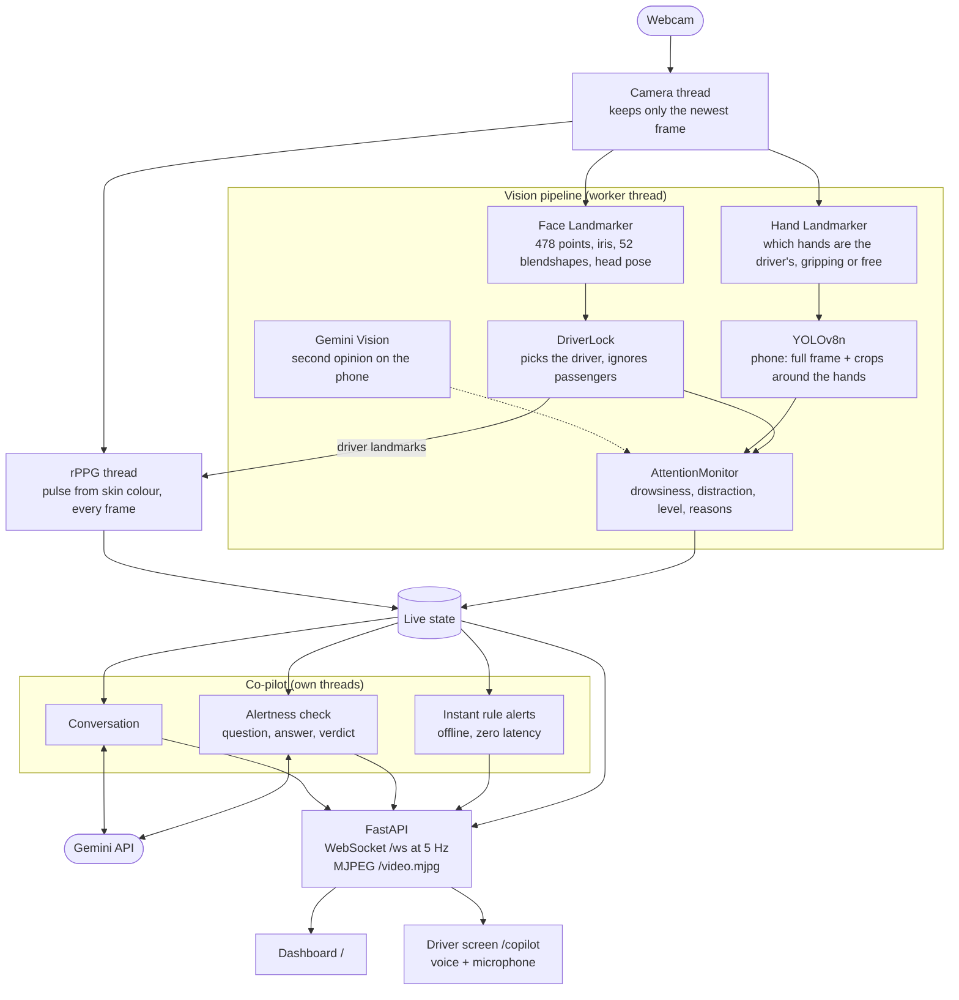
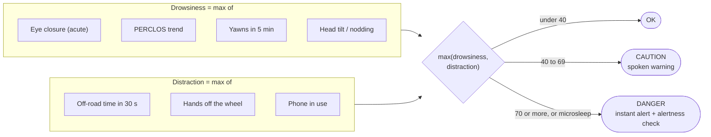
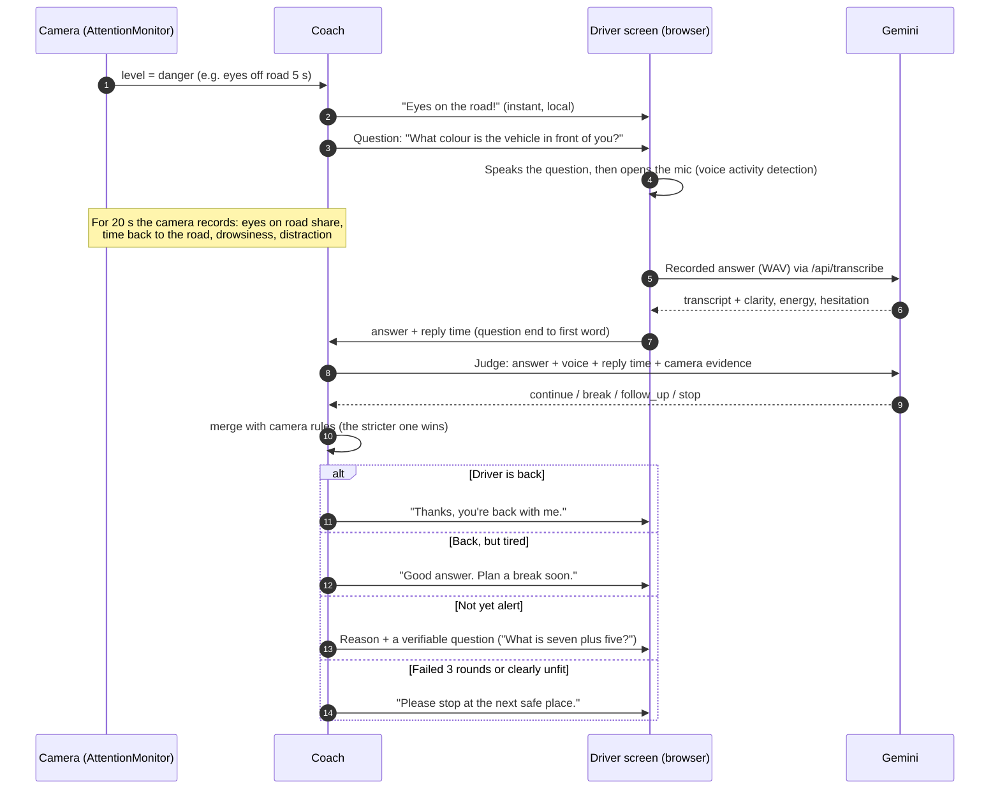

<div align="center">

# FastGears

### A live AI co-pilot that watches the driver and keeps them alert

**Codelap Hackathon 2026 · "AI Drive" challenge · Team FastGears**

Laptop CPU + webcam · no GPU, no extra sensors · works offline, smarter online

</div>

---

## In short

FastGears watches the driver through an ordinary webcam. It sees when they get **drowsy**, look
away from the road, or pick up a **phone**, and it **responds in the car**. A danger alert is
spoken right away. Then an LLM co-pilot runs a **spoken alertness check**: it asks a question,
listens to the answer, and keeps watching the driver's eyes while they reply. From all of that it
decides whether the driver is back, needs a break, or should stop the car.

The live dashboard shows every detection, the driver's pulse measured by the camera, and
everything the co-pilot says.

| Judging requirement | How FastGears meets it |
|---|---|
| **R1 Driver detection** | Eyes closed, blink rate, PERCLOS, microsleep, yawns, head drop and tilt, gaze *left / right / down / up / away*, phone in hand, hands off the wheel, and pulse from the camera. Only the driver is measured; passengers are ignored. |
| **R2 In-car reaction (LLM)** | An instant spoken alert (local, no network), then a **closed-loop check**: question → spoken answer → Gemini judges the answer, the voice and the camera evidence together. The driver can also talk to the co-pilot freely. |
| **R3 Live demo** | Everything runs live on the webcam feed. Nothing is pre-recorded or labelled. |
| **R4 Live dashboard** | Annotated video, attention banner, drowsiness and distraction gauges, all detections, a 2-minute timeline, and the co-pilot feed with voice. There is also a separate driver screen. |

---

## Contents

1. [Architecture](#1-architecture)
2. [What we measure from the camera](#2-what-we-measure-from-the-camera)
3. [From measurements to the three statistics](#3-from-measurements-to-the-three-statistics)
4. [The LLM co-pilot](#4-the-llm-co-pilot)
5. [What makes FastGears different](#5-what-makes-fastgears-different)
6. [Tools and why we chose them](#6-tools-and-why-we-chose-them)
7. [Setup and run](#7-setup-and-run)
8. [Demo script for the jury](#8-demo-script-for-the-jury)
9. [Tests, tips and troubleshooting](#9-tests-tips-and-troubleshooting)

---

## 1. Architecture

FastGears is a single Python process with three kinds of threads. **Vision threads** turn camera
frames into numbers. The **co-pilot** turns those numbers into speech. **FastAPI** streams
everything to the browser. The rule that ties them together: **the video loop never waits for the
network, and a danger alert never waits for the LLM.**



### What happens to one frame

1. **Capture.** `camera.py` reads the webcam on its own thread and keeps only the newest frame, so
   a slow step drops frames instead of falling behind real time.
2. **Faces.** MediaPipe finds every face in the frame. `DriverLock` decides which face is the
   driver's. It also runs a second, zoomed pass on a crop around the driver, so a small face in a
   wide car view is not missed.
3. **Hands and phone.** MediaPipe Hands (every 3rd frame) finds the hands and works out who each
   hand belongs to. YOLOv8n looks for a phone in the full frame and in high-resolution crops
   around the driver's hands.
4. **Attention.** `AttentionMonitor` turns the face, hand and phone readings into two scores
   (drowsiness and distraction), a level (`ok`, `caution` or `danger`) and readable reasons, for
   example *"eyes off road 6 s in the last 30 s"*.
5. **Pulse.** A separate thread samples skin colour on **every** camera frame (about 30 fps),
   using the driver's newest landmarks, because the pulse needs a higher sample rate than the
   detector loop gives.
6. **Co-pilot.** The state goes to the `Coach` 5 times a second. It speaks instant alerts and
   starts alertness checks and LLM calls on background threads.
7. **Dashboard.** FastAPI pushes the state and messages over a WebSocket and streams the
   annotated video as MJPEG. The browser speaks and listens.

### Code map

| Module | Role |
|---|---|
| `fastgears/__main__.py` | Entry point (`python -m fastgears`) and CLI flags |
| `fastgears/config.py` | All settings, from `.env` or the environment |
| `fastgears/camera.py` | Threaded webcam capture (DirectShow or MSMF on Windows) |
| `fastgears/pipeline.py` | Per-frame loop, pulse thread, video overlay, state assembly |
| `fastgears/vision/face.py` | MediaPipe face landmarks, EAR, MAR, iris offset, head pose |
| `fastgears/vision/driver.py` | `DriverLock`: driver selection, tracking, hand and phone ownership |
| `fastgears/vision/hands.py` | MediaPipe hands: gripping or free, forearm direction, open palm |
| `fastgears/vision/objects.py` | YOLOv8n phone detection, hand and driver crops, `PhoneLatch` |
| `fastgears/vision/phone_check.py` | Gemini Vision second opinion on a phone |
| `fastgears/vision/attention.py` | Drowsiness and distraction logic: scores, level, reasons |
| `fastgears/vision/rppg.py` | Camera pulse (POS algorithm) with a trust score |
| `fastgears/vision/discomfort.py` | Facial action units: grimace detection |
| `fastgears/vision/driver_signals.py` | Combines eyes, expression, colour and pulse into one finding |
| `RGB/` | Experimental facial colour analysis (CIELAB) |
| `fastgears/llm/coach.py` | Co-pilot: alerts, pacing, Gemini and Anthropic clients, chat |
| `fastgears/llm/intervention.py` | Closed-loop alertness check (state machine + judge) |
| `fastgears/llm/dialogue.py` | Speech-to-text prompt, reply alertness scoring, engagement |
| `fastgears/server.py` | FastAPI: pages, WebSocket, MJPEG, REST API |
| `fastgears/web/index.html` | Technical dashboard for the jury (no build step, no CDN) |
| `fastgears/web/copilot.html` | Driver screen: co-pilot voice, microphone, chat, vitals |
| `tests/` | 231 unit tests. No camera, model or network needed |

---

## 2. What we measure from the camera

Every value below is computed for the **driver's face only**, on every processed frame. Head
pose, eye openness and iris position are compared with the driver's **own baseline**, learned
during calibration. So glasses, face shape and camera angle do not matter.

### 2.1 Calibration (first 5 seconds)

The driver looks at the road for 5 s (or presses **Recalibrate**). FastGears records the
**median** of their open-eye EAR (skipping blink frames, limited to 0.15–0.45), their neutral
pitch, yaw and roll, and their neutral iris position, for each eye separately. Every threshold
after this is relative: "eyes closed" means *closed for this person*, and "looking left" means
*left of where this person looks at the road*.

### 2.2 Eyes

| Parameter | How it is computed | Why we need it |
|---|---|---|
| **EAR** (Eye Aspect Ratio) | Six landmarks per eye: `EAR = (‖p2−p6‖ + ‖p3−p5‖) / (2‖p1−p4‖)` (Soukupová & Čech). Smoothed for display with a One-Euro filter. The raw value is used for decisions, because blinks last only 100–300 ms. | A scale-free measure of how open the eye is. It works at any distance from the camera. |
| **Eyes closed** | `EAR < 0.6 × baseline EAR`, **or** MediaPipe's `eyeBlink` blendshape ≥ 0.5. Each eye has its own open/closed label with hysteresis, so the label doesn't flicker. | The basic event behind blinks, PERCLOS and microsleep. The blendshape catches closures that the geometry misses, for example with glasses. |
| **Eye closure** (0–1) | `(baseline − EAR) / (0.7 × baseline)`, at least the blink blendshape value, limited to 0–1. 0 means normally open, 1 means fully shut. | A continuous value. PERCLOS counts the eye as closed when this is ≥ 0.8. |
| **Eye-closed duration** | Seconds since the current closure started. | Tells a blink (< 0.5 s) from a long closure (≥ 2 s) and a **microsleep** (≥ 5 s). |
| **Blinks per minute** | Closures shorter than 0.5 s, counted over the last 60 s. | Blink rate changes with fatigue. It is shown on the dashboard and given to the LLM as context. |
| **PERCLOS** | The share of time with eye closure ≥ 80 % (the P80 standard), over the **last 5 minutes**. It is only judged once 60 s of history exist. | The most validated camera measure of drowsiness. It reacts slowly, so it shows a trend. |
| **PERCLOS, last minute** | The same measure over the last 60 s. The value actually used is `min(PERCLOS_5min, 2 × PERCLOS_1min)`. | One minute with the eyes open clears an old episode, instead of keeping "tired" for 5 minutes. |

### 2.3 Mouth

| Parameter | How it is computed | Why we need it |
|---|---|---|
| **MAR** (Mouth Aspect Ratio) | Inner-lip opening divided by inner-mouth width (landmarks 13–14 / 78–308). | A scale-free measure of how open the mouth is. |
| **Yawn** | `MAR ≥ 0.6` or the `jawOpen` blendshape ≥ 0.6, held **≥ 1.5 s**, and only while yaw and roll are within 20° of neutral. Pitch is not limited, because a real yawn tips the head back. | Talking also opens the mouth, but rarely for 1.5 s. A turned head distorts the mouth shape and would create fake yawns. |
| **Yawns in 5 min** | Yawns counted over a 5-minute window. | Yawning often shows fatigue: more than 6 yawns in 5 minutes means *tired*. |

### 2.4 Head and gaze

| Parameter | How it is computed | Why we need it |
|---|---|---|
| **Pitch / yaw / roll** | Euler angles taken from MediaPipe's 4×4 facial transformation matrix, minus the calibrated neutral pose. | Where the head points. Pitch is up/down, yaw is left/right, roll is tilt. |
| **Iris offset** | Iris centre position inside each eye, between the eye corners and the mid-lids, scaled to −1…1 and averaged over both eyes. Ignored while the eyes are closed. | The eyes can move without the head, for example a sideways glance at a phone. |
| **Gaze direction** | `gaze_yaw = yaw + 25° × Δiris_x`, `gaze_pitch = pitch + 20° × Δiris_y`. The labels: `away` if \|yaw\| ≥ 60°, `left`/`right` if \|gaze yaw\| ≥ 25°, `down` if gaze pitch ≥ 20°, `up` if ≤ −20°, otherwise `road`. A face lost for ≥ 1 s counts as `away`. Mirroring is handled, so the labels are from the driver's point of view. | Head and eyes together give where the driver is actually looking. |
| **Head tilted** | Roll ≥ 35° from neutral, for example the head lying on a shoulder. | A typical sign of falling asleep. Pitch and yaw are not reliable in that position, so it is not reported as "looking down". |
| **Head nodding / dropping** | The head is pitched past the gaze limits with drooping eyes (closure ≥ 0.3) for longer than a blink, or thrown back ≥ 35°. If the face disappears while the pitch was rising fast (≥ 8° in 0.3 s), that also counts: the chin dropped to the chest. | Tells a head nodding off from a driver looking at their lap. The first is drowsiness, the second is distraction. |
| **Off-road time** | Seconds per glance, **and** total seconds off the road over the last 30 s. | Many short glances add up. One quick mirror check does not. |

### 2.5 Hands and phone

| Parameter | How it is computed | Why we need it |
|---|---|---|
| **Hand owner** | Each hand's forearm direction (knuckles → wrist) is followed to the nearest person. A hand far on the passenger's side of the car is never the driver's. | The driver's hand raised next to a passenger's face still counts as the driver's. The passenger's hands never count. |
| **Hand free** | Fingers stretched (fingertip-to-wrist ÷ knuckle-to-wrist > 1.55) or the hand at the face. A hand gripping the wheel has its fingers curled. | A camera between the seats can see hands on the wheel too, so a visible hand is not necessarily a free hand. |
| **Hands off the wheel** | **Both** of the driver's hands free for ≥ 1.5 s. One hand on the wheel is fine. | A sign of distraction even without a recognised object. |
| **Phone in hand** | Up to three checks, combined by a latch (details below). | Phone use is one of the most dangerous distractions. |

How the phone is detected:

1. **YOLOv8n** runs on every 3rd frame. It alternates between the full frame (640 px, phone
   confidence ≥ 0.20) and a **phone-only pass on 480 px crops around each of the driver's hands**.
   The phone is almost always in a hand, and the crop gives it about twice as many pixels, so
   phones seen edge-on or half covered are found.
2. **False positives are filtered out.** A detection is dropped if it is closer to a passenger, on
   a passenger's body, on an open palm (YOLO sometimes reads the palm as a phone), or covering
   most of the driver's face (YOLO sometimes reads the head as a phone). A phone also has to be in
   the lower ⅔ of the frame or within one face width of the face.
3. **Gemini Vision second opinion.** If the driver's hand is visible but YOLO sees no phone, a
   crop is sent to Gemini at most every 5 s. A confident "yes" (≥ 0.6) counts as a hit for 4 s.
4. **PhoneLatch.** The phone counts as ON after 2 hits within 1.5 s, or after one hit with
   confidence ≥ 0.5. It goes OFF after 1.5 s without a hit, or after 4 s if the driver's hand is
   still where the phone was. YOLO loses edge-on phones for seconds at a time.

### 2.6 Pulse from the camera (rPPG)

Each heartbeat changes skin colour very slightly, mostly in the green channel. FastGears measures
the pulse **without contact** using the **POS** algorithm (Wang et al. 2017):

1. **Regions.** The forehead and both cheeks, taken as polygons from the face landmarks and
   sampled at 20 Hz on every camera frame.
2. **Pixel cleaning.** In each region, shadows and highlights are removed (pixels below the 15th
   or above the 90th brightness percentile), along with clipped pixels and glare.
3. **Motion removal.** A ridge regression removes the colour changes explained by head movement
   and scale.
4. **POS.** The RGB signal is projected onto the plane orthogonal to skin tone, in 1.6 s sliding
   windows. The result is FFT-analysed over a 6–10 s window, in the band **0.75–3 Hz (45–180 BPM)**.
5. **Regional agreement.** At least 2 regions must agree within 6 BPM. Otherwise the reading is
   only *provisional* and marked unreliable.
6. **Trust score (0–100).** `exposure × (0.3·signal SNR + 0.3·region agreement + 0.2·stability + 0.2·stillness)`.
   A score ≥ 70 is *reliable*, 40–69 *uncertain*, below 40 *unreliable*. The dashboard shows the
   reasons, for example "head moving" or "face too dark".

**Why we need it:** the heart rate gives context to the other signals. A very low pulse combined
with pale cheeks and closed eyes is a pattern worth noting. **Only a reliable pulse is ever given
to the LLM.** This estimator comes from our earlier project (afferent, Junction 2026). There it was
checked against a finger pulse sensor: **mean absolute difference 1.8 BPM, max 4 BPM**.

### 2.7 Additional signals (experimental)

| Signal | How | Why |
|---|---|---|
| **Facial grimace** (`discomfort.py`) | MediaPipe blendshapes and landmark movements mapped to facial action units: AU4 brow lowering, AU7 lid tightening, AU9 nose wrinkle, AU10 upper-lip raise, AU6 cheek raise. Each is compared with the driver's relaxed face. A *grimace* is AU4 + AU7 + (AU9 or AU10) together for ≥ 0.3 s. | A facial expression that can go with discomfort or pain. The co-pilot treats it as facial movement only and keeps any check-in neutral. It never diagnoses. |
| **Facial colour** (`RGB/`, `--rgb`) | The cheeks and lips are measured in **CIELAB**, against a personal baseline. Lighting changes are compensated using the forehead (or a grey card). Detects lasting cheek redness, loss of cheek colour, and lip-tone shifts. | Visible colour changes, combined with eye closure and pulse in `driver_signals.py`. Demo thresholds, not clinically validated. |

### 2.8 Driver lock: only the driver counts

1. **Acquire.** At start, the largest face (or the face on the `DRIVER_SEAT` side) has to win
   **5 frames in a row** to be locked. A face passing by is never locked.
2. **Track.** Each frame, the driver is the face that continues the previous one (moved less
   than 0.8 face widths, similar size). MediaPipe's face order is never trusted.
3. **Lost.** If the driver leaves the frame, the dashboard says *DRIVER NOT VISIBLE*. The lock
   **never jumps to a passenger**. Only a face back in the driver's seat (within 0.6 face widths of
   the learned position) takes the lock again.
4. **Passengers** get a grey *passenger (ignored)* box on the video. Their hands and phones never
   count.

---

## 3. From measurements to the three statistics

The dashboard shows three things: **Drowsiness** (0–100), **Distraction** (0–100) and **Phone in
use**. Phone use feeds into Distraction. The attention level comes from the higher of the two
scores:



### 3.1 Drowsiness score

| Component | Input parameters | Score |
|---|---|---|
| **Eye closure** (acute) | eye-closed duration | 0.5–2 s: rises to 39 · **2 s: 40 (caution)**, rising to 69 at 5 s · **≥ 5 s: 90, microsleep (danger)**. After the eyes reopen, it fades with a 2 s time constant. |
| **PERCLOS trend** | PERCLOS 5 min, PERCLOS 1 min | `min(60, 40 × PERCLOS_eff / 0.15)`. **15 % gives caution.** It is capped at 60, so a slow trend can raise caution but never cause danger on its own. |
| **Yawns** | yawns in 5 min | More than 6 yawns gives **50 (caution)**. A single yawn is shown, but changes nothing. |
| **Head tilt / nodding** | roll, pitch, eye closure, face loss | After 1 s: `70 × seconds / 3`, so **danger after 3 s**. |

**Drowsiness = the highest of the four.** A fast event (closed eyes) and a slow trend (PERCLOS)
are never added together, so one doesn't hide or inflate the other.

### 3.2 Distraction score

| Component | Input parameters | Score |
|---|---|---|
| **Eyes off the road** | gaze direction, face present, off-road seconds summed over the **last 30 s** | `70 × total / 5 s`: caution at about 3 s, **danger at 5 s in total**. Back on the road, the score fades within about 3 s (1 s time constant). 2 s back on the road clears "distracted". The total stays in the 30 s window, so the next glance triggers sooner. |
| **Hands off the wheel** | both of the driver's hands free for ≥ 1.5 s | **45 (caution)** |
| **Phone in use** | phone latch on, seconds in use | **55 (caution) at once**, **80 (danger) after 10 s** of use. 2 s without the phone ends the episode. |

Drowsy postures (`tilted`, `nodding`) are **never** counted as distraction. A driver whose head
falls forward is falling asleep, not looking at their lap.

### 3.3 Phone in use

Phone in use is a statistic of its own on the dashboard (the PHONE tile, with how long and from
which source: `yolo` or `gemini-vision`), and it feeds the distraction score as shown above. The
parameters it depends on: phone detections around the driver's hands, hand ownership, the
open-palm and face-cover filters, the Gemini Vision confidence, and the latch timings in §2.5.

All thresholds are named constants at the top of `fastgears/vision/attention.py`. Each one can be
changed for testing, e.g. `AttentionMonitor(microsleep_s=2.0)`.

---

## 4. The LLM co-pilot

### 4.1 Design principles

- **Safety never depends on the network.** Every danger is spoken immediately from local rules.
  The LLM only improves the wording, the check-in and the conversation.
- **The camera is a hard floor.** The LLM can make a verdict *stricter*. It can never pass a
  driver that the camera says is still in danger.
- **Speak only when something is wrong.** No summaries, no praise, no small talk. One topic per
  message: the `primary_hazard`.
- **Small, private prompts.** The LLM gets a compact JSON of numbers (level, reasons, PERCLOS,
  off-road time, reliable pulse…). Camera images are never sent, except the optional phone crop.

### 4.2 Three ways the co-pilot talks

| Mode | When | How |
|---|---|---|
| **Instant alert** | Any **danger** | Local rule text, spoken immediately, for example *"Wake up! Eyes on the road now."* Priority: microsleep → phone → head dropping → eyes closing → eyes off road → hands off the wheel → tired. |
| **Warning** | A **caution** that lasts long enough | Gemini writes a short, situation-specific sentence (≤ 20 words, JSON). If it hasn't replied **within 2.5 s**, the rule text is said instead and the late reply is dropped. |
| **Conversation** | The driver talks (microphone or text), or tiredness is detected | Gemini answers using the live state and the last 8 conversation turns. A tired driver is engaged with an easy question: *"Talk to me: where are you heading?"* |

### 4.3 The closed-loop alertness check

A beep tells the driver something is wrong. It doesn't tell anyone whether the driver is alert
again. So after a danger alert, FastGears **asks a question and judges the reaction**:



**Two kinds of question.** *Road questions* ("What is directly ahead of you?") bring the eyes back
to the road. Nobody can check the answer, so only whether it is a real answer counts. *Check
questions* ("What is seven plus five?") have one correct answer, so a wrong answer shows the mind
isn't back yet. Follow-up rounds always use check questions.

**What is judged together:**

| Evidence | Source | Rule-based limit |
|---|---|---|
| Eyes on the road while answering | camera, after a 2 s reaction grace period | ≥ 60 % of the time, no microsleep, level no longer danger |
| Reply time | browser: end of the question → first word | ≥ 8 s means not alert |
| Voice | Gemini hears the audio: `clear / mumbled / slurred`, low energy, hesitant | slurred means not alert |
| Answer content | Gemini (any language or wording) | wrong check answer means not alert |
| Drowsiness during the check | PERCLOS, yawns, drowsy hazard | passes as **break** (not "continue") |

`merge_verdict` takes the **stricter** of the rule verdict and the LLM verdict. If Gemini doesn't
reply within 6 s, the camera rules decide alone. After passing, there is a cooldown (30–180 s,
depending on the pacing preset) before the next question.

### 4.4 Judging every reply, not only check-ins

Every reply in the conversation is rated `alert / slow / poor`. Rules (reply time, one-word
answers, slurred or mumbled voice, danger while answering) are combined with Gemini's reading of
the content, and the worse of the two is kept. **Two poor replies in a row** make the co-pilot
recommend a break, even if each reply alone looked borderline. The dashboard shows this
*engagement* score live.

### 4.5 Message pacing

The co-pilot must help, not nag. The pacing can be changed live from the dashboard (**Message
frequency** card, `GET/POST /api/tuning`):

| Preset | Gap between messages | Warning must last | Repeat a danger | Pause between questions |
|---|---|---|---|---|
| Quiet | 25 s | 3 s | 30 s | 180 s |
| **Normal** (default) | 12 s | 1.5 s | 20 s | 90 s |
| Talkative | 5 s | 0.5 s | 12 s | 30 s |

One danger episode is one stream of alerts, not one per cause. Alerts stay at least 10 s apart,
but a microsleep may always interrupt. While a question is open, the co-pilot keeps measuring but
says nothing else.

### 4.6 Built to keep working during a live demo

- **Model fallback chain.** Quotas are per model. When `gemini-3.1-flash-lite` returns 429 or 404,
  the next model in `GEMINI_FALLBACK_MODELS` takes over for the rest of the session.
- **Minimal thinking, 15 s timeout.** Fast replies, and a stalled connection can't block a thread.
- **No API key?** Everything still runs with rule-based messages and the browser's own speech
  recognition (Chrome or Edge).
- **Providers:** Gemini (default), Anthropic Claude (`LLM_PROVIDER=anthropic`), or `none`.

---

## 5. What makes FastGears different

1. **It checks whether the driver is alert again, instead of just beeping.** After a danger alert
   it asks a question, then judges the answer, the voice and the eyes together. Most driver
   monitoring systems stop at the alarm.
2. **The voice is used as a signal.** Gemini hears the raw audio and rates clarity (clear,
   mumbled, slurred), energy and hesitation. The browser measures the reply time to the
   millisecond.
3. **Safe even when the LLM is wrong.** The camera rules are a hard floor that the LLM can't
   override. Danger alerts never wait for the network, and the system works fully offline.
4. **Calibrated to each driver.** All eye and head thresholds are relative to the driver's own
   5-second baseline, so glasses, face shapes and camera positions all work.
5. **Only the driver is measured.** The lock is seat-based and never jumps to a passenger, and
   hands are assigned to people by forearm direction.
6. **The phone is searched for in the hand.** YOLO runs on crops around the driver's hands, false
   positives are filtered (open palms, faces), and Gemini Vision gives a second opinion.
7. **Pulse from the webcam, with an honest trust score.** Three facial regions must agree, the
   reading comes with its reasons, and only reliable readings reach the LLM. Validated at 1.8 BPM
   mean error.
8. **Distraction is measured the way glances add up.** Off-road time is summed over 30 s, so
   repeated short glances count and a single quick look doesn't trigger a false alarm.
9. **No special hardware.** It runs on a laptop CPU and webcam, has no build step, and loads
   nothing from a CDN.
10. **Tested.** 231 tests run in about 15 s without a camera, model or network. All logic takes
    time as an input, so every scenario can be replayed exactly.

---

## 6. Tools and why we chose them

### Computer vision

| Tool | Used for | Why |
|---|---|---|
| **MediaPipe Face Landmarker** | 478 face landmarks incl. iris, 52 blendshapes, head-pose matrix | All the face signals from one model, in real time on a CPU, ~4 MB |
| **MediaPipe Hand Landmarker** | 21 landmarks per hand, up to 4 hands | Hand ownership (forearm direction) and gripping vs free hands |
| **Ultralytics YOLOv8n** (COCO) | Phone (`cell phone`, class 67) and person detection | The smallest YOLO (~6 MB), fast enough on a CPU when run every 3rd frame |
| **PyTorch (CPU build)** | Runs YOLO | Ultralytics needs it. The CPU wheel keeps the install small |
| **OpenCV** | Camera capture, image processing, overlay drawing, JPEG encoding, CIELAB conversion | The standard tool, with DirectShow and MSMF backends on Windows |
| **NumPy** | rPPG signal processing (POS, FFT, ridge regression), geometry | Fast vector maths without extra dependencies |
| **POS algorithm** (Wang et al. 2017) | Pulse from skin colour | Works well under ordinary lighting with a single camera |
| **One-Euro filter** | Smoothing the displayed EAR | Low jitter without lag: blinks stay sharp |

### AI / LLM

| Tool | Used for | Why |
|---|---|---|
| **Google Gemini** (`google-genai`), default `gemini-3.1-flash-lite` | Warning wording, check-in judge, conversation, **speech-to-text with voice analysis**, phone vision check | One fast multimodal API for text, audio and images. ~1 s replies, and the free tier is enough for a demo |
| **Anthropic Claude** (optional, `anthropic`) | Alternative text provider | Lets us switch providers without code changes |
| **Rule engine** (our own) | Instant alerts, fallback verdicts, offline mode | Zero latency and always available: safety can't depend on the network |

### Backend and frontend

| Tool | Used for | Why |
|---|---|---|
| **FastAPI + Uvicorn** | HTTP API, WebSocket, MJPEG stream | Async, minimal, with WebSocket support built in |
| **WebSocket** (`/ws`) | Live state at 5 Hz plus co-pilot messages | Push updates in real time, no polling |
| **MJPEG** (`/video.mjpg`) | The annotated video in the browser | Works in any `` tag. No WebRTC setup |
| **Pydantic** | Request validation | Comes with FastAPI |
| **python-dotenv** | Settings and secrets in `.env` | Keeps keys out of the code and out of git |
| **Vanilla HTML / CSS / JS + Canvas** | Both dashboards and the timeline charts | No build step and no CDN: works offline at the venue |
| **Web Speech API** (`speechSynthesis`) | The co-pilot's voice | Built into the browser, no extra service |
| **Web Audio API** | Microphone recording, voice activity detection, WAV encoding, reply-time measurement | Records only the reply and measures when the driver starts speaking |
| **Web Speech API** (`SpeechRecognition`) | Speech-to-text fallback without Gemini | Chrome and Edge have it built in |

### Development

| Tool | Used for |
|---|---|
| **Python 3.10–3.12** | Runtime (MediaPipe has no wheels for 3.13 yet) |
| **pytest + httpx** | 231 unit and API tests, no hardware needed |
| **Camo** (optional) | An iPhone as a high-quality USB webcam, see [README_CAMO.md](README_CAMO.md) |
| **FFmpeg** (optional) | Opening a Windows camera by name (`--camera "dshow:Camo"`) |

---

## 7. Setup and run

**You need:** Python **3.10–3.12**, a webcam, Chrome or Edge (for voice), and a Gemini API key
(the free tier works; create one at <https://aistudio.google.com/apikey>).

### Windows (PowerShell)

```powershell
git clone https://github.com/bbeatricecretu/AI_FastGears.git
cd AI_FastGears
py -3.12 -m venv .venv
.venv\Scripts\python -m pip install --upgrade pip
.venv\Scripts\python -m pip install -r requirements-dev.txt --extra-index-url https://download.pytorch.org/whl/cpu
copy .env.example .env
notepad .env        # set GEMINI_API_KEY=...
```

### macOS / Linux

```bash
git clone https://github.com/bbeatricecretu/AI_FastGears.git && cd AI_FastGears
python3.12 -m venv .venv
.venv/bin/python -m pip install --upgrade pip
.venv/bin/python -m pip install -r requirements-dev.txt --extra-index-url https://download.pytorch.org/whl/cpu
cp .env.example .env   # then set GEMINI_API_KEY
```

The `--extra-index-url` installs the small CPU build of PyTorch. The models (`face_landmarker.task`,
`hand_landmarker.task`, `yolov8n.pt`) download into `models/` automatically on first run.

### Run

```powershell
.venv\Scripts\python -m fastgears
```

- **Dashboard (jury):** <http://127.0.0.1:8000>
- **Driver screen (voice and microphone):** <http://127.0.0.1:8000/copilot>

Click the page once (browsers only allow speech after a click), then look at the camera for 5 s
to calibrate.

| Flag | Effect |
|---|---|
| `--camera 1` | Use the second webcam (`--camera-backend msmf` for Camo) |
| `--no-objects` | Skip YOLO and hands (faster on weak laptops) |
| `--no-rppg` | Skip the camera pulse |
| `--no-llm` | Rule-based messages only |
| `--rgb [--rgb-overlay]` | Experimental facial colour analysis (see [RGB/README.md](RGB/README.md)) |
| `--host 0.0.0.0` | Open the dashboard from another device on the LAN |

Main `.env` settings: `GEMINI_MODEL`, `GEMINI_FALLBACK_MODELS`, `LLM_PROVIDER`, `DRIVER_SEAT`
(`left | right | auto`), `MESSAGE_PRESET`, `CHECKIN`, `CHECKIN_ANSWER_S`, `CHECKIN_MAX_ROUNDS`,
`PHONE_VISION_CHECK`, `YOLO_EVERY`, `CALIBRATION_S`. See [.env.example](.env.example).

**API:** `GET /api/state` · `GET /api/messages` · `POST /api/chat` · `POST /api/transcribe` ·
`POST /api/recalibrate` · `GET|POST /api/tuning` · `GET|POST /api/voice` · `GET /api/health` ·
`WS /ws` · `GET /video.mjpg`

---

## 8. Demo script for the jury

About 2 minutes, everything live:

1. **Sit normally.** The banner says **ATTENTIVE**. The pulse appears after about 10 s.
2. **Look left or at your lap**, on and off, until 5 s of off-road time add up: **DANGER**, a
   voice alert, then the **alertness check**. Answer the question out loud.
3. **Hold up a phone:** a warning at once, **DANGER after 10 s**, then a check-in.
4. **Close your eyes:** a warning at 2 s, **microsleep → DANGER at 5 s** (*"Wake up!"*).
5. **Let your head drop or tilt to the side:** *head dropping* → DANGER after 3 s.
6. **Yawn several times, or keep your eyes half-closed:** PERCLOS rises and the co-pilot suggests a
   break.
7. **Ask the co-pilot** *"How am I doing?"* (microphone or text). It answers from the live state.
8. **Lean a second person into the frame:** they get a grey *passenger (ignored)* box, and their
   phone doesn't count.

---

## 9. Tests, tips and troubleshooting

```powershell
.venv\Scripts\python -m pytest -q
```

The tests run without a camera, models or network. They use a synthetic 72 BPM pulse video,
scripted attention scenarios, and a fake LLM for the co-pilot.

**For good readings:** put the camera at eye level in front of the driver, 0.5–1 m away, with the
whole face visible. The pulse needs a still face and steady **white** light. Coloured light,
backlight or a flickering screen ruin it, and the trust score will say so.

| Symptom | Fix |
|---|---|
| `No matching distribution found for mediapipe` | Use Python 3.10–3.12 |
| Dashboard shows "no camera" | Try `--camera 1`; close Teams, Zoom or other apps using the camera; check the Windows camera privacy settings |
| LLM provider shows `rules` | `GEMINI_API_KEY` missing or invalid in `.env` |
| No voice | Click the page once, check the **Voice on** button, use Chrome or Edge |
| Phone never detected | Hold it visibly, in good light. `YOLO_MODEL=yolov8s.pt` is more accurate but slower |
| Slow on a weak laptop | `--no-objects` or `YOLO_EVERY=5` |
